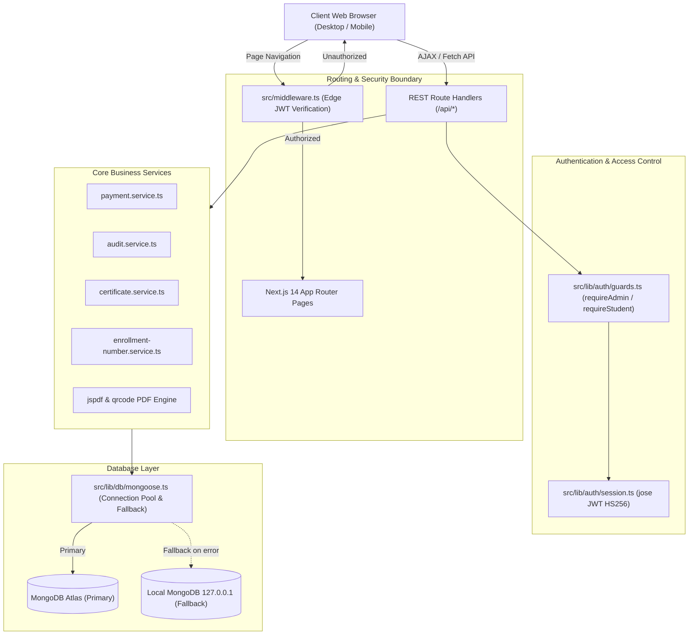
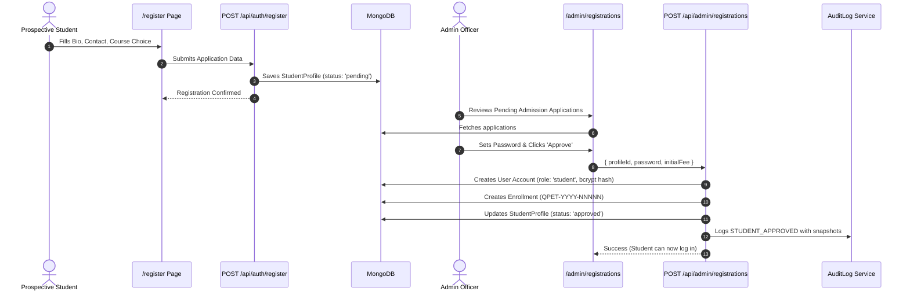
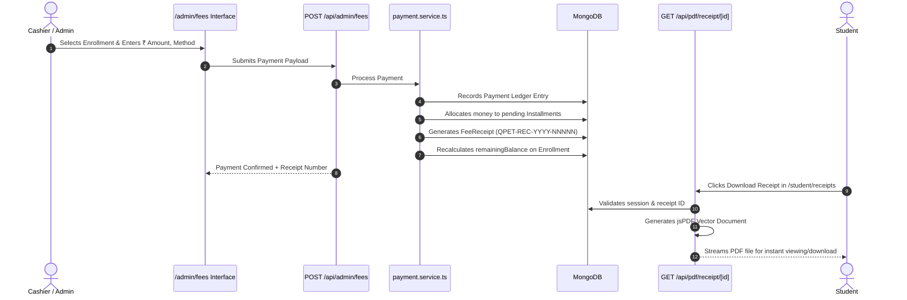
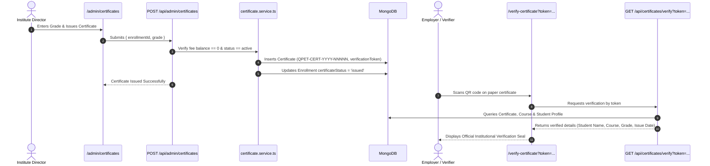
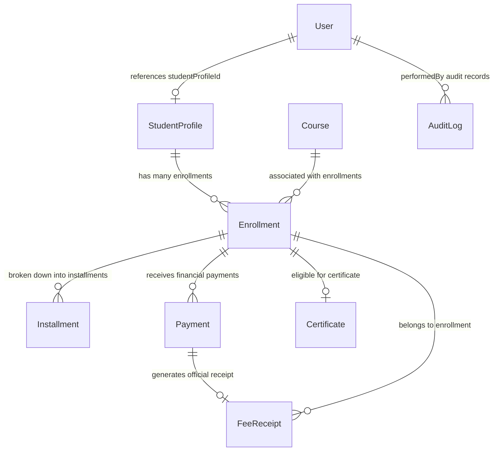

# QPET LMS — Complete Project Architecture & Technical Documentation

> **Generated on:** October 21, 2026  
> **Project Root:** `d:/new projects - 8 oct 26/QPET LMS`  
> **Development Port:** `3005` (`http://localhost:3005`)  
> **Runtime Environment:** Next.js 14.2 (App Router), React 18, TypeScript 5.7, Tailwind CSS 3.4, Mongoose 8.10, MongoDB (Atlas with Local Dual-Fallback), Jose JWT, BCryptJS.

---

## 1. Project Overview

**QPET LMS** (Quick Professional Education & Training - Learning Management System) is an enterprise-grade education management portal tailored for computer training institutes, academies, and vocational education centers.

### Key Highlights
* **Full-Stack Next.js 14 (App Router):** Utilizes React Server Components, Client Components, Edge Middleware, and REST Route Handlers under `src/app/api/`.
* **Database & Dual-Fallback Architecture:** Seamless Mongoose connection with automatic fallback from cloud-hosted MongoDB Atlas to a local MongoDB instance (`mongodb://127.0.0.1:27017/qpet_lms`) if cloud network, IP whitelisting, or TLS issues occur.
* **Role-Based Access Control (RBAC):** Distinct interfaces, permissions, and session validation for two user roles:
  * **Admin:** Complete institutional oversight, admissions approval, student credential generation, fee collection, installment tracking, certificate issuance, and immutable audit logs.
  * **Student:** Self-registration, personal course progress, fee installment ledger, digital PDF receipt downloads, and cryptographically verified completion certificates.
* **Security & Authentication:** Stateless JWT sessions (`jose` library) signed with HS256, sealed inside HTTP-only, `SameSite=Lax` cookies named `qpet_session`. Passwords are protected using 10-round salted `bcryptjs` hashing.
* **Document & PDF Engine:** Real-time client and server vector PDF generation using `jspdf` along with real-time vector QR code generation using `qrcode` for fee receipts and graduation certificates.
* **Tamper-Proof Public Verification:** Public endpoint (`/verify-certificate`) and API (`/api/certificates/verify`) allowing employers and institutions to verify certificate authenticity with strict PII (Personally Identifiable Information) masking.

---

## 2. Complete Folder & File Tree

```
d:/new projects - 8 oct 26/QPET LMS/
│
├── .env.local                          # Environment variables (DB URI, JWT secret, app URL)
├── next.config.mjs                     # Next.js configuration (reactStrictMode, headers, webpack)
├── package.json                        # Dependencies, scripts (runs on port 3005)
├── postcss.config.mjs                  # PostCSS plugins for Tailwind CSS
├── tailwind.config.ts                  # Tailwind theme, typography, color palette configuration
├── tsconfig.json                       # TypeScript compiler configuration (path aliases @/* -> ./src/*)
│
├── public/                             # Static assets (favicons, public images, icons)
│
└── src/
    ├── middleware.ts                   # Edge-compatible session router guard (admin/student RBAC)
    │
    ├── app/                            # Next.js 14 App Router (Pages, Layouts, API Handlers)
    │   ├── globals.css                 # Global styles, Tailwind base/components/utilities, scrollbars
    │   ├── layout.tsx                  # Root HTML layout with Inter font and Toaster
    │   ├── page.tsx                    # Public landing page (Hero, features, course highlights, CTA)
    │   ├── login/
    │   │   └── page.tsx                # Unified login portal for Admin and Students
    │   ├── register/
    │   │   └── page.tsx                # Public student self-registration form
    │   ├── verify-certificate/
    │   │   └── page.tsx                # Public certificate verification lookup & display
    │   │
    │   ├── admin/                      # Admin Protected Portal
    │   │   ├── layout.tsx              # Admin shell (Sidebar navigation, header, auth guard)
    │   │   ├── dashboard/page.tsx      # Admin overview (KPI cards, monthly charts, pending approvals)
    │   │   ├── students/page.tsx       # Student directory, profile editor, password resets, drop status
    │   │   ├── registrations/page.tsx  # Admission inbox (Approve with credential creation, Reject)
    │   │   ├── courses/page.tsx        # Course catalog manager (CRUD, fee structures, syllabus)
    │   │   ├── enrollments/page.tsx    # Active student-course enrollments & status tracking
    │   │   ├── fees/page.tsx           # Installment manager & payment collection interface
    │   │   ├── receipts/page.tsx       # Searchable fee receipt ledger with PDF download
    │   │   ├── certificates/page.tsx   # Certificate issuance engine & revocation panel
    │   │   ├── reports/page.tsx        # Financial analytics, enrollment stats, RFC-4180 CSV exports
    │   │   └── audit-logs/page.tsx     # Immutable audit trails with JSON before/after diff inspector
    │   │
    │   ├── student/                    # Student Protected Portal
    │   │   ├── layout.tsx              # Student shell (Sidebar, user header, logout)
    │   │   ├── dashboard/page.tsx      # Student personal dashboard (Course progress, fee summary, alerts)
    │   │   ├── courses/page.tsx        # Enrolled courses, syllabus details, duration, batch timings
    │   │   ├── fees/page.tsx           # Ledger of installments paid, upcoming dues, payment history
    │   │   ├── receipts/page.tsx       # Personal fee receipts with one-click PDF download
    │   │   └── certificates/page.tsx   # Verified issued certificates with QR code & PDF download
    │   │
    │   └── api/                        # Backend REST Route Handlers
    │       ├── auth/
    │       │   ├── login/route.ts      # Auth identifier verification, bcrypt compare, JWT cookie creation
    │       │   ├── logout/route.ts     # Cookie eviction (qpet_session cleared)
    │       │   ├── me/route.ts         # Current authenticated user & profile resolution
    │       │   └── register/route.ts   # Public admission submission handler (saves StudentProfile)
    │       │
    │       ├── admin/
    │       │   ├── dashboard/route.ts  # Aggregated statistics, monthly revenue, pending counts
    │       │   ├── students/route.ts   # Student list, status updates, drop course, credentials reset
    │       │   ├── registrations/route.ts # Admission pipeline (Approve -> User account + Enrollment)
    │       │   ├── courses/route.ts    # Course CRUD & active status toggling
    │       │   ├── enrollments/route.ts# Enrollment management, batch assignment, status tracking
    │       │   ├── fees/route.ts       # Fee collection handler (Payment record + Installment auto-allocation)
    │       │   ├── receipts/route.ts   # Query fee receipts by enrollment or receipt number
    │       │   ├── certificates/route.ts # Eligibility check, certificate issuance, revocation
    │       │   ├── reports/route.ts    # Financial and enrollment aggregated metrics & export data
    │       │   └── audit-logs/route.ts # Filtered query of immutable audit log records
    │       │
    │       ├── student/
    │       │   ├── dashboard/route.ts  # Current student's courses, pending dues, announcements
    │       │   ├── courses/route.ts    # Current student's course details & syllabus
    │       │   ├── fees/route.ts       # Current student's payment history & upcoming installments
    │       │   └── certificates/route.ts # Current student's issued certificates
    │       │
    │       ├── certificates/
    │       │   └── verify/route.ts     # Public tamper-proof verification API (PII sanitized)
    │       │
    │       └── pdf/
    │           ├── receipt/[id]/route.ts     # Dynamic vector PDF stream for fee receipts
    │           └── certificate/[id]/route.ts # Dynamic vector PDF stream with QR code for certificates
    │
    ├── components/                     # Reusable UI Components
    │   ├── admin/
    │   │   └── AdminSidebar.tsx        # Admin navigation bar with active indicators and logout
    │   └── student/
    │       └── StudentSidebar.tsx      # Student navigation bar with personal profile preview
    │
    └── lib/                            # Core Business Logic, Data Access & Shared Services
        ├── db/
        │   └── mongoose.ts             # Cached Mongoose connection with Atlas-to-Local auto-fallback
        │
        ├── models/                     # Mongoose Schemas & TypeScript Models
        │   ├── User.ts                 # Auth accounts (identifier, passwordHash, role, status)
        │   ├── StudentProfile.ts       # Admission bio, contact, father name, registration status
        │   ├── Course.ts               # Course catalog (code, title, duration, fee, syllabus)
        │   ├── Enrollment.ts           # Student-to-course binding, enrollmentNumber, payment status
        │   ├── EnrollmentCounter.ts    # Atomic sequence numbers by year for IDs, receipts, certs
        │   ├── Installment.ts          # Scheduled payment tranches with due dates and balances
        │   ├── Payment.ts              # Financial transactions ledger (amount, method, adminId)
        │   ├── FeeReceipt.ts           # Immutable fee receipt snapshots (receiptNumber, balances)
        │   ├── Certificate.ts          # Issued credentials (certificateNumber, verificationToken, grade)
        │   └── AuditLog.ts             # Immutable change history with JSON diffs
        │
        ├── auth/
        │   ├── session.ts              # JWT signing, verification, cookie extraction via `jose`
        │   └── guards.ts               # Server-side route handler guards (requireAdmin, requireStudent)
        │
        ├── services/
        │   ├── audit.service.ts        # Asynchronous non-blocking audit trail generator
        │   ├── enrollment-number.service.ts # Atomic sequence generator for formatted IDs
        │   ├── payment.service.ts      # Installment balance calculator, auto-allocator & receipt creator
        │   └── certificate.service.ts  # Certificate eligibility verification, issue & revoke logic
        │
        ├── pdf/
        │   ├── certificate-pdf.ts      # Server-side jsPDF certificate document with embedded QR
        │   └── receipt-pdf.ts          # Server-side jsPDF standard fee receipt generator
        │
        └── export/
            └── csv.ts                  # RFC-4180 compliant CSV serializer with UTF-8 BOM for Excel
```

---

## 3. Important Files & Functional Analysis (Easy Hinglish)

### 3.1. Infrastructure & Core Gateways

#### `package.json`
* **Purpose:** Project metadata, dependencies, aur scripts define karta hai.
* **Key Details:**
  * `"dev": "next dev -p 3005"` — Ensures the server explicitly binds to Port 3005 to avoid port collision with other local services.
  * Dependencies include `@types/node`, `@types/react`, `bcryptjs`, `jose`, `jspdf`, `lucide-react`, `mongoose`, `next`, `qrcode`, `react`, `tailwindcss`.
* **Hinglish Explanation:** Ye poore project ka command center hai jo batata hai kaunse npm modules install hain aur app kis port par run hogi.

#### `src/lib/db/mongoose.ts`
* **Purpose:** MongoDB connection lifecycle management.
* **Key Details:** 
  * Next.js ke hot-reload cycle mein redundant connections prevent karne ke liye `global.mongooseConn` caching implement karta hai.
  * **Dual-Fallback Mechanism:** Primary connection `MONGODB_URI` (MongoDB Atlas replica set) par attempt hota hai. Agar Atlas IP whitelist, firewall ya network drop ki wajah se fail hota hai, toh connection automatically local instance `mongodb://127.0.0.1:27017/qpet_lms` par switch ho jata hai without throwing fatal errors.
* **Hinglish Explanation:** Ye database ki lifeline hai. Agar internet chala jaye ya cloud database connect na ho, toh ye bina server band kiye turant aapke local database se jud jata hai.

#### `src/middleware.ts`
* **Purpose:** Edge runtime request interceptor jo unauthorized users ko block karta hai.
* **Key Details:**
  * Cookie `qpet_session` inspect karta hai.
  * `jose.jwtVerify` se signature decode karke role (`admin` vs `student`) check karta hai.
  * Path `/admin/*` ko exclusively role `admin` ke liye allow karta hai.
  * Path `/student/*` ko exclusively role `student` ke liye allow karta hai.
  * Role violation ya missing token hone par `/login?callbackUrl=...` par HTTP 307 redirect karta hai.
* **Hinglish Explanation:** Gatekeeper guard jo bina login kiye ya wrong role ke sath admin ya student area mein ghusne se rokta hai.

---

### 3.2. Authentication & Authorization

#### `src/lib/auth/session.ts`
* **Purpose:** JWT token creation, verification, and cookie serialization.
* **Functions:**
  * `createSession(payload)`: User identifier, ID, role aur optional studentProfileId ko encode karta hai; 7 days expiration ke sath `qpet_session` cookie set karta hai (`httpOnly: true, sameSite: 'lax'`).
  * `verifySessionToken(token)`: JWT signature check karta hai using `JWT_SECRET`.
  * `destroySession()`: Cookie ko expire karke user ko logout karta hai.
* **Hinglish Explanation:** User ke login karne par digital pass (JWT token) banata hai aur browser cookie mein safely store karta hai.

#### `src/lib/auth/guards.ts`
* **Purpose:** API Route Handlers ke andar granular authorization checks.
* **Functions:**
  * `requireAdmin()`: API request mein `admin` role verify karta hai, fail hone par 401/403 throw karta hai.
  * `requireStudent()`: API request mein `student` role verify karta hai.
* **Hinglish Explanation:** Backend APIs ka internal lock system, jo ensure karta hai ki students admin APIs ko call na kar sakein.

---

### 3.3. Database Models (`src/lib/models/`)

| Model File | Collection | Purpose & Key Fields |
| :--- | :--- | :--- |
| `User.ts` | `users` | Auth accounts. Fields: `identifier` (unique login ID / mobile / email), `passwordHash` (bcrypt), `role` (`admin` / `student`), `status` (`active` / `inactive`), `studentProfileId` (ref). |
| `StudentProfile.ts` | `studentprofiles` | Student admission bio. Fields: `fullName`, `fatherOrGuardianName`, `mobileNumber`, `email`, `dateOfBirth`, `gender`, `address`, `preferredCourseId`, `registrationStatus` (`pending`, `approved`, `rejected`, `dropped`, `inactive`), `dropReason`. |
| `Course.ts` | `courses` | Course catalog. Fields: `code` (e.g. `ADCA`, `DCA`), `title`, `durationMonths`, `defaultFee`, `syllabusSummary`, `isActive`. |
| `Enrollment.ts` | `enrollments` | Student-course binding. Fields: `enrollmentNumber` (`QPET-YYYY-NNNNN`), `studentProfileId`, `courseId`, `feeAgreed`, `paidAmount`, `remainingBalance`, `paymentStatus`, `certificateStatus`, `status`. |
| `EnrollmentCounter.ts` | `enrollmentcounters` | Atomic sequence counters per calendar year. Fields: `year`, `lastEnrollmentSequence`, `lastReceiptSequence`, `lastCertificateSequence`. |
| `Installment.ts` | `installments` | Scheduled payment tranches. Fields: `enrollmentId`, `installmentNumber`, `amount`, `dueDate`, `paidAmount`, `status` (`unpaid`, `partial`, `paid`, `overdue`). |
| `Payment.ts` | `payments` | Financial ledger. Fields: `enrollmentId`, `amount`, `paymentMethod` (`cash`, `upi`, `bank_transfer`), `transactionReference`, `recordedByAdminId`. |
| `FeeReceipt.ts` | `feereceipts` | Printable receipt snapshots. Fields: `receiptNumber` (`QPET-REC-YYYY-NNNNN`), `paymentId`, `enrollmentId`, `amount`, `balanceRemainingAtPayment`. |
| `Certificate.ts` | `certificates` | Issued credentials. Fields: `certificateNumber` (`QPET-CERT-YYYY-NNNNN`), `verificationToken` (secure crypto hash), `enrollmentId`, `grade`, `status` (`valid`, `revoked`). |
| `AuditLog.ts` | `auditlogs` | Immutable audit records. Fields: `action`, `performedByRole`, `performedById`, `targetEntity`, `targetId`, `beforeSnapshot`, `afterSnapshot`, `createdAt`. |

---

### 3.4. Services & Business Logic (`src/lib/services/`)

* **`audit.service.ts`:** System state badalne par (e.g., student approved, password reset, fee collected) background mein non-blocking immutable `AuditLog` entry create karta hai with full JSON diff.
* **`enrollment-number.service.ts`:** Year-based atomic counter maintain karta hai via MongoDB `$inc` to produce clean IDs (`QPET-YYYY-NNNNN`, `QPET-REC-YYYY-NNNNN`, `QPET-CERT-YYYY-NNNNN`).
* **`payment.service.ts`:** Fee payments receive karta hai, chronological order mein installments settle karta hai, remaining balance recalculate karta hai, aur instant `FeeReceipt` generate karta hai.
* **`certificate.service.ts`:** Verify karta hai ki kya student ki fees fully clear hai aur enrollment valid hai, phir cryptographically secure verification token ke sath graduation certificate issue karta hai.

---

### 3.5. PDF & Data Export (`src/lib/pdf/` & `src/lib/export/`)

* **`receipt-pdf.ts`:** Client/Server `jspdf` document generate karta hai with official institute header, student bio, payment mode, receipt number, balance remaining, and authorized signatory seal.
* **`certificate-pdf.ts`:** High-res landscape vector certificate generate karta hai with golden borders, student name, course title, grade, completion date, and real-time generated scannable QR code linking to public verification page.
* **`csv.ts`:** RFC-4180 standard compliant CSV serializer with UTF-8 Byte Order Mark (`\uFEFF`) taaki Hindi/Devanagari text and special characters Microsoft Excel mein seamlessly open hon.

---

## 4. Application Architecture & Data Flow

### 4.1. Architecture Diagram



---

### 4.2. End-to-End Workflow Sequences

#### Admission & Credential Creation Workflow


#### Fee Collection & Instant Receipt Generation


#### Certificate Issuance & Public QR Verification


---

## 5. Page and Route Mapping Table

| URL / Route | Corresponding File Path | Purpose | Data Source | Related API Endpoints | Auth Requirement |
| :--- | :--- | :--- | :--- | :--- | :--- |
| `/` | `src/app/page.tsx` | Institute landing page, highlights, course cards | Static / Catalog | None | Public |
| `/login` | `src/app/login/page.tsx` | Unified login for Admin and Students | Form Input | `/api/auth/login` | Public |
| `/register` | `src/app/register/page.tsx` | Public student admission submission | Form Input + Course List | `/api/auth/register`, `/api/admin/courses` | Public |
| `/verify-certificate` | `src/app/verify-certificate/page.tsx` | Public certificate lookup & QR scan target | Public API | `/api/certificates/verify` | Public |
| `/admin/dashboard` | `src/app/admin/dashboard/page.tsx` | KPI cards, monthly revenue, pending counts | API | `/api/admin/dashboard` | Role: `admin` |
| `/admin/students` | `src/app/admin/students/page.tsx` | Student list, profile edit, drop course, reset credentials | API | `/api/admin/students` | Role: `admin` |
| `/admin/registrations` | `src/app/admin/registrations/page.tsx` | Admission applications review, approve, set password | API | `/api/admin/registrations` | Role: `admin` |
| `/admin/courses` | `src/app/admin/courses/page.tsx` | Create, edit, toggle active status of courses | API | `/api/admin/courses` | Role: `admin` |
| `/admin/enrollments` | `src/app/admin/enrollments/page.tsx` | Enrolled students, batch assignment, fee progress | API | `/api/admin/enrollments` | Role: `admin` |
| `/admin/fees` | `src/app/admin/fees/page.tsx` | Fee collection, installment schedules & balances | API | `/api/admin/fees` | Role: `admin` |
| `/admin/receipts` | `src/app/admin/receipts/page.tsx` | Fee receipts directory & vector PDF downloads | API | `/api/admin/receipts`, `/api/pdf/receipt/[id]` | Role: `admin` |
| `/admin/certificates` | `src/app/admin/certificates/page.tsx` | Issue certificates, verify eligibility, revoke | API | `/api/admin/certificates`, `/api/pdf/certificate/[id]` | Role: `admin` |
| `/admin/reports` | `src/app/admin/reports/page.tsx` | Revenue analytics, enrollment summaries, CSV export | API | `/api/admin/reports` | Role: `admin` |
| `/admin/audit-logs` | `src/app/admin/audit-logs/page.tsx` | Audit trail viewer with JSON before/after diffs | API | `/api/admin/audit-logs` | Role: `admin` |
| `/student/dashboard` | `src/app/student/dashboard/page.tsx` | Student overview: course status, fees, alerts | API | `/api/student/dashboard` | Role: `student` |
| `/student/courses` | `src/app/student/courses/page.tsx` | My enrolled courses, syllabus outline, duration | API | `/api/student/courses` | Role: `student` |
| `/student/fees` | `src/app/student/fees/page.tsx` | Installment breakdown, paid history, upcoming dues | API | `/api/student/fees` | Role: `student` |
| `/student/receipts` | `src/app/student/receipts/page.tsx` | Student's own receipts with one-click PDF download | API | `/api/student/fees`, `/api/pdf/receipt/[id]` | Role: `student` |
| `/student/certificates` | `src/app/student/certificates/page.tsx` | Issued certificates with QR code and PDF download | API | `/api/student/certificates`, `/api/pdf/certificate/[id]` | Role: `student` |

---

## 6. Complete API Reference Table

| Method | Endpoint | Handler File | Purpose | Required Inputs | DB Interaction | Auth Guard |
| :--- | :--- | :--- | :--- | :--- | :--- | :--- |
| `POST` | `/api/auth/login` | `src/app/api/auth/login/route.ts` | Authenticate user, set JWT cookie | `{ identifier, password }` | Reads `User` | None (Public) |
| `POST` | `/api/auth/logout` | `src/app/api/auth/logout/route.ts` | Evict session cookie | None | None | None |
| `GET` | `/api/auth/me` | `src/app/api/auth/me/route.ts` | Get logged-in user profile info | Session Cookie | Reads `User`, `StudentProfile` | Authenticated |
| `POST` | `/api/auth/register` | `src/app/api/auth/register/route.ts` | Submit admission application | `{ fullName, mobileNumber, courseId, ... }` | Inserts `StudentProfile` | None (Public) |
| `GET` | `/api/admin/dashboard` | `src/app/api/admin/dashboard/route.ts` | Get aggregated admin metrics | None | Reads `User`, `Payment`, `Enrollment` | `requireAdmin()` |
| `GET` | `/api/admin/students` | `src/app/api/admin/students/route.ts` | List students with status filter | Query: `?status=...&search=...` | Reads `StudentProfile`, `User` | `requireAdmin()` |
| `PATCH`| `/api/admin/students` | `src/app/api/admin/students/route.ts` | Update student profile, reset password, drop course | `{ studentId, action, ... }` | Updates `StudentProfile`, `User`, `Enrollment` | `requireAdmin()` |
| `GET` | `/api/admin/registrations` | `src/app/api/admin/registrations/route.ts` | List pending admission applications | Query: `?status=pending` | Reads `StudentProfile`, `Course` | `requireAdmin()` |
| `POST` | `/api/admin/registrations` | `src/app/api/admin/registrations/route.ts` | Approve admission, create user credentials & enrollment | `{ profileId, password, initialFee }` | Inserts `User`, `Enrollment`, updates `StudentProfile` | `requireAdmin()` |
| `GET` | `/api/admin/courses` | `src/app/api/admin/courses/route.ts` | List all courses | Query: `?includeInactive=true` | Reads `Course` | Public / Admin |
| `POST` | `/api/admin/courses` | `src/app/api/admin/courses/route.ts` | Create or update course | `{ code, title, durationMonths, defaultFee, ... }`| Inserts/Updates `Course` | `requireAdmin()` |
| `GET` | `/api/admin/enrollments` | `src/app/api/admin/enrollments/route.ts` | List student enrollments | Query: `?courseId=...&status=...` | Reads `Enrollment`, `StudentProfile`, `Course` | `requireAdmin()` |
| `POST` | `/api/admin/fees` | `src/app/api/admin/fees/route.ts` | Collect fee, allocate installments, create receipt | `{ enrollmentId, amount, paymentMethod, notes }` | Inserts `Payment`, `FeeReceipt`, updates `Enrollment`, `Installment` | `requireAdmin()` |
| `GET` | `/api/admin/receipts` | `src/app/api/admin/receipts/route.ts` | Query fee receipts | Query: `?enrollmentId=...` | Reads `FeeReceipt`, `Payment`, `Enrollment` | `requireAdmin()` |
| `GET` | `/api/admin/certificates` | `src/app/api/admin/certificates/route.ts` | List issued certificates | Query: `?status=...` | Reads `Certificate`, `Enrollment` | `requireAdmin()` |
| `POST` | `/api/admin/certificates` | `src/app/api/admin/certificates/route.ts` | Issue completion certificate | `{ enrollmentId, grade }` | Inserts `Certificate`, updates `Enrollment` | `requireAdmin()` |
| `GET` | `/api/admin/reports` | `src/app/api/admin/reports/route.ts` | Aggregate finance/enrollment data & CSV export | Query: `?format=csv&type=...` | Reads `Payment`, `Enrollment`, `StudentProfile` | `requireAdmin()` |
| `GET` | `/api/admin/audit-logs` | `src/app/api/admin/audit-logs/route.ts` | Query immutable audit log records | Query: `?action=...&limit=50` | Reads `AuditLog` | `requireAdmin()` |
| `GET` | `/api/student/dashboard` | `src/app/api/student/dashboard/route.ts` | Current student's dashboard metrics | Session Cookie | Reads `Enrollment`, `Installment`, `Certificate` | `requireStudent()` |
| `GET` | `/api/student/courses` | `src/app/api/student/courses/route.ts` | Current student's enrolled courses | Session Cookie | Reads `Enrollment`, `Course` | `requireStudent()` |
| `GET` | `/api/student/fees` | `src/app/api/student/fees/route.ts` | Current student's fee ledger & installments | Session Cookie | Reads `Enrollment`, `Installment`, `Payment`, `FeeReceipt` | `requireStudent()` |
| `GET` | `/api/student/certificates` | `src/app/api/student/certificates/route.ts` | Current student's issued certificates | Session Cookie | Reads `Certificate`, `Enrollment` | `requireStudent()` |
| `GET` | `/api/certificates/verify` | `src/app/api/certificates/verify/route.ts` | Public verification lookup | Query: `?token=...` or `?certNo=...` | Reads `Certificate`, `Enrollment`, `Course`, `StudentProfile` | Public (PII Sanitized) |
| `GET` | `/api/pdf/receipt/[id]` | `src/app/api/pdf/receipt/[id]/route.ts` | Stream vector PDF fee receipt | Path: `id` | Reads `FeeReceipt`, `Payment`, `Enrollment` | Authenticated |
| `GET` | `/api/pdf/certificate/[id]` | `src/app/api/pdf/certificate/[id]/route.ts` | Stream vector PDF certificate with QR code | Path: `id` | Reads `Certificate`, `Enrollment`, `Course` | Authenticated / Public Token |

---

## 7. Database Documentation & Data Schema

### 7.1. Entity Relationships (ER Overview)



### 7.2. Detailed Schema Definitions

#### 1. `users` (`src/lib/models/User.ts`)
* `identifier`: String (Indexed, Unique) — Admin email or Student mobile number.
* `passwordHash`: String — 10-round salted bcrypt hash.
* `role`: String enum (`'admin'` | `'student'`).
* `status`: String enum (`'active'` | `'inactive'` | `'suspended'`).
* `studentProfileId`: ObjectId (Ref: `StudentProfile`, optional for admin).

#### 2. `studentprofiles` (`src/lib/models/StudentProfile.ts`)
* `fullName`: String.
* `fatherOrGuardianName`: String.
* `mobileNumber`: String (Indexed).
* `email`: String (Optional).
* `dateOfBirth`: Date.
* `gender`: String enum (`'male'` | `'female'` | `'other'`).
* `address`: String.
* `preferredCourseId`: ObjectId (Ref: `Course`).
* `registrationStatus`: String enum (`'pending'` | `'approved'` | `'rejected'` | `'dropped'` | `'inactive'`).
* `dropReason`: String (Stored when student drops course mid-way).
* `dropDate`: Date.

#### 3. `courses` (`src/lib/models/Course.ts`)
* `code`: String (Unique, Indexed, e.g. `ADCA`, `DCA`).
* `title`: String.
* `durationMonths`: Number.
* `defaultFee`: Number.
* `syllabusSummary`: [String].
* `isActive`: Boolean (Default: `true`).

#### 4. `enrollments` (`src/lib/models/Enrollment.ts`)
* `enrollmentNumber`: String (Unique, e.g. `QPET-2026-00001`).
* `studentProfileId`: ObjectId (Ref: `StudentProfile`).
* `courseId`: ObjectId (Ref: `Course`).
* `feeAgreed`: Number.
* `paidAmount`: Number (Default: 0).
* `remainingBalance`: Number.
* `paymentStatus`: String enum (`'pending'` | `'partial'` | `'completed'`).
* `certificateStatus`: String enum (`'not_eligible'` | `'eligible'` | `'issued'`).
* `status`: String enum (`'active'` | `'completed'` | `'dropped'`).

#### 5. `enrollmentcounters` (`src/lib/models/EnrollmentCounter.ts`)
* `year`: Number (Unique, e.g. 2026).
* `lastEnrollmentSequence`: Number (Default: 0).
* `lastReceiptSequence`: Number (Default: 0).
* `lastCertificateSequence`: Number (Default: 0).

#### 6. `installments` (`src/lib/models/Installment.ts`)
* `enrollmentId`: ObjectId (Ref: `Enrollment`).
* `installmentNumber`: Number.
* `amount`: Number.
* `dueDate`: Date.
* `paidAmount`: Number.
* `status`: String enum (`'unpaid'` | `'partial'` | `'paid'` | `'overdue'`).

#### 7. `payments` (`src/lib/models/Payment.ts`)
* `enrollmentId`: ObjectId (Ref: `Enrollment`).
* `amount`: Number.
* `paymentMethod`: String enum (`'cash'` | `'upi'` | `'bank_transfer'`).
* `transactionReference`: String.
* `notes`: String.
* `recordedByAdminId`: ObjectId (Ref: `User`).

#### 8. `feereceipts` (`src/lib/models/FeeReceipt.ts`)
* `receiptNumber`: String (Unique, e.g. `QPET-REC-2026-00001`).
* `paymentId`: ObjectId (Ref: `Payment`).
* `enrollmentId`: ObjectId (Ref: `Enrollment`).
* `amount`: Number.
* `balanceRemainingAtPayment`: Number.

#### 9. `certificates` (`src/lib/models/Certificate.ts`)
* `certificateNumber`: String (Unique, e.g. `QPET-CERT-2026-00001`).
* `verificationToken`: String (Unique, crypto random hex string).
* `enrollmentId`: ObjectId (Ref: `Enrollment`).
* `issueDate`: Date.
* `grade`: String (e.g. `'A+'`, `'A'`, `'B'`).
* `status`: String enum (`'valid'` | `'revoked'`).

#### 10. `auditlogs` (`src/lib/models/AuditLog.ts`)
* `action`: String (e.g. `STUDENT_APPROVED`, `PASSWORD_RESET`, `FEE_COLLECTED`).
* `performedByRole`: String enum (`'admin'` | `'student'` | `'system'`).
* `performedById`: ObjectId (Ref: `User`).
* `targetEntity`: String.
* `targetId`: String.
* `beforeSnapshot`: Mixed (JSON).
* `afterSnapshot`: Mixed (JSON).
* `ipAddress`: String.
* `createdAt`: Date.

---

## 8. Authentication and Security Audit

1. **Password Encryption:** All passwords are salted and hashed using 10 rounds of `bcryptjs`. Plaintext passwords are never stored in the database.
2. **Stateless JWT Sessions:** Sessions are signed with HMAC SHA-256 (`HS256`) using `JWT_SECRET`. Tokens expire after 7 days.
3. **Cookie Hardening:**
   * `httpOnly: true` (Inaccessible to client-side scripts, neutralizing XSS credential theft).
   * `sameSite: 'lax'` (Provides defense against Cross-Site Request Forgery).
   * `secure: process.env.NODE_ENV === 'production'`.
4. **Dual-Layer Access Control:**
   * *Layer 1:* `src/middleware.ts` runs at the Next.js edge and intercepts routing before page execution.
   * *Layer 2:* `requireAdmin()` and `requireStudent()` in `src/lib/auth/guards.ts` protect individual API route handlers.
5. **Public Verification Sanitization:**
   * `/api/certificates/verify` strictly excludes student mobile numbers, email addresses, residential addresses, and fee payment details to protect student privacy while allowing employers to verify certificates.

---

## 9. Dependencies & Configuration Summary

* **Main Framework:** Next.js 14.2 (App Router), React 18, TypeScript 5.7.
* **Styling:** Tailwind CSS 3.4, PostCSS, Lucide React icons.
* **Database:** MongoDB via Mongoose 8.10.
* **Authentication:** `jose` (JWT), `bcryptjs` (password hashing).
* **Document Generation:** `jspdf` (vector PDFs), `qrcode` (scannable QR codes).
* **Environment Variables Required:**
  * `MONGODB_URI`: Cloud Atlas connection URI (with fallback to local MongoDB).
  * `JWT_SECRET`: Secret key for cryptographic signing of user sessions.
  * `NEXT_PUBLIC_APP_URL`: Institute public domain (used in QR code verification URLs).
  * `PORT`: Server port (configured to `3005`).

---

## 10. Change Impact Map

| When You Want To... | Inspect These Files | Dependencies & Potential Side Effects |
| :--- | :--- | :--- |
| **Redesign Admin Dashboard UI** | `src/app/admin/dashboard/page.tsx`<br>`src/components/admin/AdminSidebar.tsx`<br>`src/app/admin/layout.tsx` | Purely visual. Does not alter API contracts or database schema. |
| **Add a New Field to Registration** | 1. `src/lib/models/StudentProfile.ts`<br>2. `src/app/register/page.tsx`<br>3. `src/app/api/auth/register/route.ts`<br>4. `src/app/admin/registrations/page.tsx` | Requires adding field to Mongoose schema and handling existing records with defaults. |
| **Modify Course Fees or Installments** | 1. `src/lib/models/Enrollment.ts`<br>2. `src/lib/services/payment.service.ts`<br>3. `src/app/api/admin/fees/route.ts` | Financial calculations must be verified. Check installment distribution logic. |
| **Create a New API Endpoint** | 1. Create `src/app/api/[module]/route.ts`<br>2. Protect using `src/lib/auth/guards.ts`<br>3. Log with `src/lib/services/audit.service.ts` | Ensure route path matches `src/middleware.ts` RBAC rules. |
| **Modify Authentication Rules** | 1. `src/lib/auth/session.ts`<br>2. `src/middleware.ts`<br>3. `src/app/api/auth/login/route.ts` | Modifying session lifetime will require active users to re-login. |

---

## 11. Issues and Recommendations

### 11.1. Confirmed Issues
1. **Invalid ID in PDF Endpoints:**
   * In `/api/pdf/receipt/[id]` and `/api/pdf/certificate/[id]`, invalid or malformed ObjectIds can cause an unhandled Mongoose `CastError` resulting in HTTP 500 instead of HTTP 404.
   * *Fix:* Add `mongoose.Types.ObjectId.isValid(id)` guard before querying.

### 11.2. Potential Risks
1. **Atlas IP Whitelisting in Production:**
   * The dual-fallback mechanism falls back to local MongoDB seamlessly during local development, but in production cloud environments (such as Vercel or AWS), local MongoDB is unavailable. Ensure Atlas Network Access allows connections from your production environment (`0.0.0.0/0` or static IPs).

### 11.3. Improvement Suggestions
1. **Client-Side Data Fetching:**
   * Pages currently fetch data using raw `useEffect` + `fetch()`. Implementing SWR or TanStack Query would provide instant client caching, smooth refetching, and better loading state transitions.
2. **Pagination on High Volume Datasets:**
   * Receipts and Audit Logs currently query with `.limit(50)` or `.limit(100)`. Adding page-based or cursor-based pagination will ensure consistent performance as student counts scale into thousands.

---

## 12. Beginner-Friendly Summary: How the Whole System Works

1. **Student Registration (`/register`):** Prospective students submit their admission form online. The details are safely recorded in the database under `studentprofiles` with status `pending`.
2. **Admin Approval & Credentials (`/admin/registrations`):** The administrator inspects incoming applications in the inbox, assigns a login password, and clicks "Approve". The system automatically creates a `User` account, generates a sequential `Enrollment` number, and creates the course installment payment schedule.
3. **Student Access & Payments (`/student/dashboard` & `/admin/fees`):** The student logs into their private portal using their mobile number and password to track course milestones and installment due dates. When payment is made, the admin collects the fee, and an official PDF `FeeReceipt` is generated immediately.
4. **Graduation & QR Verification (`/admin/certificates` & `/verify-certificate`):** Upon course completion and full fee settlement, the institute issues a graduation certificate equipped with a unique QR code. Employers scanning the QR code on a paper certificate are directed to the official verification page, confirming the certificate's validity instantly.
